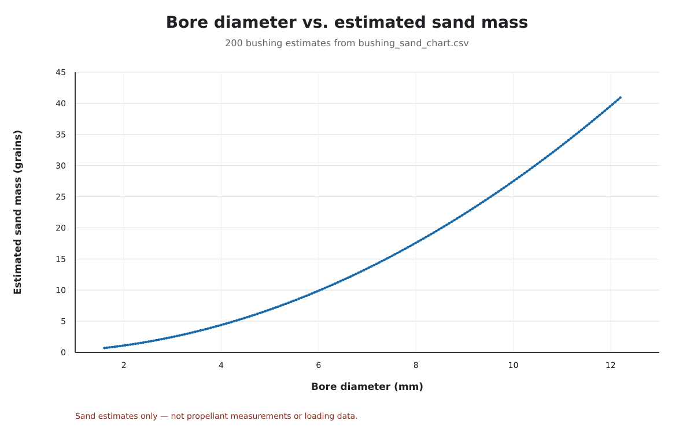

# Lee Load-All II Bushings

> **DISCLAIMER — USE AT YOUR OWN RISK.** Measurements and mass values are estimates and may be inaccurate. All files and information are provided “AS IS.” You are responsible for verifying them and for any use or consequences. No creator or contributor accepts liability except where applicable law does not allow it to be excluded.

Regenerated source files and STL exports for a 200-piece Lee Load-All II bushing set.

## Disclaimer, no warranties, and assumption of risk

All dimensions, bore measurements, volumes, sand mass estimates, fit assumptions, and other measurements or descriptions in this repository are approximate, may contain errors or omissions, and are not guaranteed to be accurate, complete, or suitable for any purpose. Independently verify all measurements and material behavior before relying on them.

All models, code, charts, documentation, and other materials are provided **“AS IS,” “WITH ALL FAULTS,” and “AS AVAILABLE,”** without warranties or guarantees of any kind, express or implied, including warranties of accuracy, merchantability, fitness for a particular purpose, title, non-infringement, safety, fit, or performance.

You assume all risk and responsibility for accessing, printing, manufacturing, assembling, modifying, testing, storing, using, or relying on these materials, and for determining whether any activity complies with applicable laws and regulations. To the fullest extent permitted by applicable law, the creator and contributors disclaim responsibility and liability for any loss, claim, injury, death, or damage of any kind arising from or related to these materials or their use, including direct, indirect, incidental, special, consequential, or punitive damages.

Some warranties or liabilities cannot be excluded or limited in some jurisdictions. Nothing in this notice excludes or limits liability or rights that applicable law does not allow to be excluded or limited. This notice is not a guarantee that any particular disclaimer is legally enforceable in every jurisdiction.

The chart’s mass estimates are based on the sand density constant in `generate_all.py`; they describe the documented sand test material and are not propellant measurements, powder charges, or loading data.

## Estimated sand mass by bore diameter



This visualization plots the CSV estimates for sand only.

## Contents

- `lee_bushing.scad` — OpenSCAD source used by the batch generator.
- `lee_bushing_customizer.scad` — Customizer source for parameterized models.
- `generate_all.py` — generates the 200 numbered STL files and CSV chart in `lee_sand_bushings_oem_fit/` (requires the OpenSCAD command-line application).
- `generate_renders.py` — generates selected preview images from the OpenSCAD source.
- `generate_chart.py` — regenerates the SVG chart from the CSV using Python’s standard library.
- `docs/estimated-sand-mass-vs-bore.svg` — chart embedded above.
- `lee_sand_bushings_oem_fit/` — the 200 STL exports and `bushing_sand_chart.csv`.

## Regenerate the STL set

From the repository root, with OpenSCAD installed and available as `openscad` on `PATH`:

```sh
python3 generate_all.py
```

This rewrites the STL files and chart in `lee_sand_bushings_oem_fit/`.
